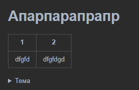

sdfsdfsdf sd sdfsdfsd fsdfsd fsdffsdfsd | < [ - * fddfgdgggdgfdgdgfg

маркированный список:

- dfdfgfdgfgfdgdfgdfg
    - fddggfdggd
        - sddfdfggdgfdg
            - dfgdfgdfgdfgdfg
                - sfsfdsf
                    - sdsdfsdf
- dfdggfdgfdgfdgfdgfdg
  dfgfdg

<ul>
    <li>элемент 1</li>
    <li>элемент 2</li>
</ul>

нумерованный список:

1. один.
    2. два
        3. три
            4. четыре
5. пять
6. шесть

| 1     | 2 |
|-------|---|
| dfgfd |   |

**начало** текста [ссылка на что, то внутри текста] продолжение
начало текста [ссылка на что, то внутри текста]( продолжение

начало текста [ссылка на что, то внутри текста](продолжение

) dfgfgdfgdfg

начало текста [ссылка на что, то внутри текста](продолжение
) dfgfgdfgdfg

*начало текста [ссылка на что, то внутри текста](sdfsdfsfsdf) продолжение*

**начало текста [ссылка на что, то внутри текста](sdfsdfsfsdf) продолжение**

***начало текста [ссылка на что, то внутри текста](sdfsdfsfsdf) продолжение***

начало текста [ссылка *на* **что**, то ***внутри*** текста](sdfsdfsfsdf) продолжение

начало текста  продолжение

*на одной строке начинаем 123123 !@#$%^&()_+
на другйо заканчиваем*

*на одной строке начинаем*

*dfgfdg
dgfdgfd*

*sdfdsf

1. dsfsdf
2. sdfsdf
   sdfsdfd*

*sdsdf
| 1 | 2 |
|-------|---------|
| dfgfd | |
sfdsf*

Какие бывают у нас элементы

1. Блочные
    2. Таблица
    3. Списки
    4. Строка
2. Строчные
    3. Ссылка
    4. Картинка
    5. Стиль шрифта (Курсив, Жирный, Зачеркнутый)

//паттерн дял поиска, кривой.
*([^\s\*][^\*]*[^\s\*])\*
